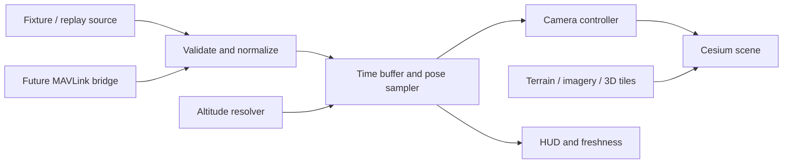

# Synthetic FPV: preliminary discovery

## Recommendation

Build a small standalone CesiumJS viewer, driven by a generic telemetry source. Begin with latitude, longitude, explicitly referenced altitude, and timestamps. Derive course from movement and use a level horizon with a configurable downward camera angle. Add measured aircraft attitude later without changing the position transport.

Treat the existing MapLibre ground station as a potential consumer of the same telemetry contract. This workspace was empty during discovery; its earlier implementation was not available for inspection. A separate cockpit pane can share state with that station later. Choosing Cesium here does not require replacing its map.

This document records the preliminary discovery. A subsequent minimal prototype now exists; see the root README for implemented scope and verification limits. The broader architecture below remains a proposal.

## Reference inspected

Repository: [bilawalsidhu/gods-eye-view](https://github.com/bilawalsidhu/gods-eye-view), commit `4d88dd29f59c1dfb1efb69435112b3b17293d3c7`, inspected October 15, 2026. Links below pin that revision. A shallow reference checkout was downloaded outside this workspace to `/tmp/gods-eye-view-discovery`.

| Responsibility | Source | Relevant behavior |
| --- | --- | --- |
| Viewer | [src/app/viewer.js](https://github.com/bilawalsidhu/gods-eye-view/blob/4d88dd29f59c1dfb1efb69435112b3b17293d3c7/src/app/viewer.js) | Cesium Viewer with most standard controls disabled. |
| Cockpit lifecycle | [src/ui/cockpitTrackingController.js](https://github.com/bilawalsidhu/gods-eye-view/blob/4d88dd29f59c1dfb1efb69435112b3b17293d3c7/src/ui/cockpitTrackingController.js) | Hides the tracked model, releases normal entity tracking, disables camera input, requests continuous rendering. |
| Camera | [src/ui/cockpitCamera.js](https://github.com/bilawalsidhu/gods-eye-view/blob/4d88dd29f59c1dfb1efb69435112b3b17293d3c7/src/ui/cockpitCamera.js) | Reads position at viewer time, stabilizes motion, builds local ENU direction/up vectors, calls `camera.setView`. |
| Update hook | [src/ui/cockpitController.js](https://github.com/bilawalsidhu/gods-eye-view/blob/4d88dd29f59c1dfb1efb69435112b3b17293d3c7/src/ui/cockpitController.js) | Mutates camera during `scene.preUpdate`, before scene traversal/culling. Its comment identifies tile refinement problems with later `preRender` mutation. |
| Constants | [src/ui/cockpitPresentation.js](https://github.com/bilawalsidhu/gods-eye-view/blob/4d88dd29f59c1dfb1efb69435112b3b17293d3c7/src/ui/cockpitPresentation.js) | Camera 20 Hz, HUD 10 Hz, heading slew 28°/s, pitch −4°, offsets 7 m forward and 2.6 m up, minimum ground clearance 12 m. |
| Motion helpers | [src/cockpitMath.js](https://github.com/bilawalsidhu/gods-eye-view/blob/4d88dd29f59c1dfb1efb69435112b3b17293d3c7/src/cockpitMath.js) | Shortest-angle heading smoothing and bounded correction of an inertially advanced camera anchor. |
| Flight motion | [src/layers/flights/motion.js](https://github.com/bilawalsidhu/gods-eye-view/blob/4d88dd29f59c1dfb1efb69435112b3b17293d3c7/src/layers/flights/motion.js) | Delayed interpolation, dead reckoning and terrain floors for sparse aircraft feeds. Much more machinery than a single local vehicle needs. |
| Photogrammetry | [src/maps/google3d.js](https://github.com/bilawalsidhu/gods-eye-view/blob/4d88dd29f59c1dfb1efb69435112b3b17293d3c7/src/maps/google3d.js) | Loads Google Photorealistic 3D Tiles through configured direct access or Cesium ion; returns an OSM fallback route on failure. |
| Terrain | [src/maps/terrain.js](https://github.com/bilawalsidhu/gods-eye-view/blob/4d88dd29f59c1dfb1efb69435112b3b17293d3c7/src/maps/terrain.js) | Cesium World Terrain with explicit token, or keyless Re:Earth ellipsoidal mesh, with flat-ellipsoid fallback. |
| Vertical datum | [src/data/geoid.js](https://github.com/bilawalsidhu/gods-eye-view/blob/4d88dd29f59c1dfb1efb69435112b3b17293d3c7/src/data/geoid.js) | Lazy EGM96 lookup; converts MSL height to ellipsoidal height using h = H + N. |

The cockpit effect is a camera placement and stabilization problem over streamed geographic assets. It does not require a cockpit mesh, flight dynamics, or a video feed. The inspected camera uses track and fixed pitch, rather than measured roll/pitch/yaw. Consequently it approximates a forward view along travel, not necessarily the direction the vehicle's nose points—especially for a hovering or sideways-moving multirotor.

Its stabilization also matters: sparse feed corrections can look harmless on a map icon but cause the whole world to surge in first person. The reference advances an anchor using speed/course and converges toward the displayed flight position at a bounded rate. We should borrow the principle, but tune buffering for local telemetry instead of copying delays intended for distant aircraft feeds.

## Smallest useful prototype

Use Vite, TypeScript and CesiumJS, with a plain HTML HUD. No framework is necessary for this scope. This is a proposed implementation, not an installed stack.

Include one full-screen view, one vehicle, a deterministic replay route, altitude override with explicit datum, course-follow camera, pitch/FOV controls, pause/restart, and a small status HUD. Display position, source altitude/reference, resolved camera altitude, heading source, sample age, and environment provider/loading status. Use zero vehicle offsets initially; add a configurable camera mount later.

Exclude flight search, ADS-B ingestion, contact rosters, models, voice, weather, sensor filters, regional information, and ground-station commands. None is necessary to produce the requested view.

Suggested modules:

| Module | Boundary |
| --- | --- |
| `telemetry/types.ts` | Draft provided here; domain types only, no Cesium/MAVLink dependency. |
| `telemetry/validate.ts` | Runtime checks, finite numbers, range/identity/version checks; TypeScript alone cannot validate wire input. |
| `telemetry/replay.ts` | Emits fixture samples on a monotonic clock; supports rate, pause, restart, jitter/dropout scenarios. |
| `telemetry/websocket.ts` | Future JSON stream adapter implementing the same subscription interface. |
| `pose/buffer.ts` | Bounded ordered sample history per vehicle/session; timestamp mapping and freshness. |
| `pose/altitude.ts` | Resolves MSL, ellipsoid, home-relative or AGL to ellipsoid height. |
| `pose/sample.ts` | Interpolates position/orientation; derives missing course; bounds prediction. |
| `view/camera.ts` | Converts resolved pose to Cesium coordinates and sets camera before traversal. |
| `view/environment.ts` | Configures terrain, imagery, optional photogrammetry, credits and loading states. |

Only `types.ts` exists at this stage. The fixture is three invented one-second samples near San Francisco at constant ellipsoidal height; it is not a surveyed flight or a terrain-clearance assertion.

## Input and camera semantics

The draft [contract](../src/telemetry/types.ts) uses degrees, meters, milliseconds and optional NED velocity. Each sample has vehicle/session identity and source time on a monotonic session timeline. An adapter maps boot or epoch time into that timeline; the consumer stamps receipt time locally. Never compare sender and receiver monotonic clocks directly. A restart creates a new session and clears interpolation history.

Position-only sources need no attitude or speed. Estimate course from successive distinct positions, with a configurable movement threshold to suppress GPS jitter. Hold the last reliable course while stationary; before enough movement exists, use a user-specified initial heading. Mark that heading as inferred. Do not synthesize roll from a turn and present it as measured attitude.

Proposed starting policy, to tune with recorded data:

- Interpolate on a configurable delayed timeline; begin around 200 ms for a 10 Hz fixture. Increase the delay for lower-rate streams if smoothness is more valuable than latency. Show configured delay separately from sample age.
- Interpolate positions in ECEF for short local segments and use shortest-angle interpolation for course. Validate antimeridian crossing; avoid naive longitude interpolation. Larger gaps should reacquire rather than interpolate through the Earth.
- Predict for at most 500 ms beyond the newest source sample when valid velocity exists; then hold. With position alone, initially hold beyond the newest sample. Declare stale after a configurable 2 seconds without fresh position.
- Reject duplicates/late samples under an explicit ordering policy; reject unreasonable jumps or start a new acquisition segment. Do not spend many seconds easing across a source reset.
- Orientation freshness is independent of position freshness. Expired attitude returns to clearly labeled course mode. Eventually use quaternion interpolation for measured attitude and compose a camera-mount transform.
- Update the camera on rendered frames in `preUpdate`; throttle HUD DOM writes separately. Render cadence and telemetry cadence must remain independent.

These are design defaults, not guarantees of the inspected project. Acceptance testing should choose thresholds appropriate to the actual vehicle and link.

## Altitude must have a reference

Cesium's [Cartesian3.fromDegrees](https://cesium.com/learn/cesiumjs/ref-doc/Cartesian3.html#fromDegrees) takes ellipsoid-relative height. A bare value such as “100 m altitude” is insufficient to locate the camera vertically.

| Input | Resolution |
| --- | --- |
| WGS84 ellipsoid | Use meters directly. |
| MSL / orthometric | Add local geoid undulation: h = H + N; record which geoid model is used. |
| Above home | Add to home altitude in its declared absolute datum, then resolve that datum. Above home is not AGL. |
| AGL | Add to sampled bare-earth terrain ellipsoid height at the current location. Requires terrain data at each location. |

Use ellipsoid fixtures first to isolate camera behavior. Make fixed-altitude override a source-independent transform that retains original telemetry for readouts. Do not silently substitute zero ground height if terrain/geoid data is unavailable: show unresolved/degraded status and hold the last resolved pose or require explicit fallback selection.

Separate bare-earth terrain from rendered mesh surfaces. A photogrammetry sample might hit a roof or tree, so it cannot automatically define AGL. An optional visualization clearance mode may lift the camera above a loaded surface, but it must report the adjustment and leave source altitude intact. The reference's 12 m clamp is unsuitable as an invisible default when evaluating low-altitude telemetry.

## Environment choice

Cesium is the recommended first experiment because the reference already demonstrates the required geographic camera transforms, terrain and 3D Tiles integration. MapLibre remains a reasonable map/HUD companion; this discovery does not claim it cannot support a custom 3D camera.

Test two environment configurations behind one provider boundary:

1. Terrain plus licensed aerial imagery: enough to assess route-following and terrain relief, without assuming detailed buildings exist.
2. Google Photorealistic 3D Tiles in a covered area: closer to the reference's visual effect. Google describes these as a textured 3D mesh of real-world areas in its [3D Tiles documentation](https://developers.google.com/maps/documentation/tile/3d-tiles).

Confirm coverage, texture quality at intended altitude, cold/warm loading time, tile popping, GPU memory, and provider attribution on the target machine. Terrain alone will not reproduce textured city geometry. Missing tiles must be visible as an environment issue rather than mistaken for missing telemetry. A network outage must not reset the vehicle state.

Provider accounts, allowed usage, current quotas/pricing and credentials remain implementation prerequisites to verify for the chosen deployment. No cost estimate or coverage guarantee was established here. Keep credentials/configuration outside the pose layer and preserve provider credits.

## ArduPilot path

Use a small local bridge (for example Python/pymavlink) to read serial or UDP MAVLink and emit normalized JSON over WebSocket. The browser renderer should never depend on MAVLink message layouts. Both replay and bridge feed the same contract. Start with a receive-only visualization path.

Mappings below follow the primary [MAVLink message definitions](https://mavlink.io/en/messages/common.html#GLOBAL_POSITION_INT):

| Message / field | Normalized value |
| --- | --- |
| `GLOBAL_POSITION_INT.lat`, `.lon` | Degrees = value / 1e7. Use the fused global position stream initially. |
| `.alt` | MSL meters = value / 1000; resolve geoid before rendering. |
| `.relative_alt` | Meters above home = value / 1000; requires known home datum/height. |
| `.vx`, `.vy`, `.vz` | NED m/s = value / 100; down remains positive in transport. |
| `.hdg` | Vehicle heading = value / 100 degrees; 65535 means unknown. This is not course. |
| `.time_boot_ms` | Map boot-relative milliseconds to source session; handle reboot and wrap. |
| `ATTITUDE` | Convert roll/pitch/yaw radians to degrees, preserving its source timestamp. |

Derive ground course from `atan2(east, north)` when horizontal velocity is reliable. Use yaw/heading for an eventual nose-mounted camera. The bridge must reconcile asynchronous position and attitude messages with independent freshness and selected MAVLink system/component identity; an unrelated vehicle's attitude must never be attached to the current position.

MAVLink attitude uses body forward-right-down and local NED conventions. Convert those frames deliberately to the Cesium camera's direction/up vectors; do not copy Euler fields directly into the camera without testing axis and sign conventions. See [ATTITUDE definitions](https://mavlink.io/en/messages/common.html#ATTITUDE).

Start testing against ArduPilot SITL and recorded messages. Request rates appropriate to bandwidth; ArduPilot documents `MAV_CMD_SET_MESSAGE_INTERVAL` and other options in [Requesting Data From The Autopilot](https://ardupilot.org/dev/docs/mavlink-requesting-data.html). Suggested initial rates are 5–10 Hz position and 20 Hz attitude, subject to actual link capability. Verify acknowledgments and achieved rates instead of assuming requests succeed.

## Build sequence and evidence required

1. **Replay over terrain.** Implement validation, replay clock, datum resolution, course derivation and camera. Verify a fixed point, cardinal directions, a constant-altitude route, stationary jitter, north wrap and dateline crossing. Compare camera coordinates against known inputs.
2. **Real-area visual comparison.** Run one urban route and one terrain-heavy route at several altitudes with imagery/terrain and photogrammetry. Record provider, coverage, machine, frame time, cold/warm loading and visible geometry limits. This decides whether the result meets the intended FPV quality.
3. **Stream resilience.** Exercise 1/5/10 Hz, jitter, delayed/out-of-order samples, disconnect, reconnect, replay seek and vehicle/session change. Assert bounded prediction, stale hold, visible status and bounded memory. Check MSL conversion, home-relative resolution and unavailable AGL terrain separately.
4. **ArduPilot adapter.** Replay known MAVLink records, then use SITL. Validate units, timestamps, source identity, heading/course distinction, attitude signs and altitude against SITL/ground-station values. Swap sources without changing renderer code.

Completion of the first prototype means a reproducible route produces a smooth forward view over real terrain, altitude semantics are visible, and a second source can drive it through the same interface. Detailed cockpit decoration can follow after that evidence exists.

## Reuse and remaining decisions

Prefer a fresh small implementation informed by the reference. Its controller is coupled to tracked aircraft layers, many DOM elements, terrain services and briefing/context features; copying it wholesale would retain the unwanted product scope. The repository declares MIT licensing; preserve its copyright/license notice if copying code or substantial portions. Imagery/terrain data have their own terms.

The main choices before implementation are the target region and altitude range, whether “given altitude” means MSL/AGL/above home, acceptable latency, and whether the intended camera follows travel or measured vehicle orientation. The proposed defaults allow discovery to proceed without committing to a live telemetry transport.
